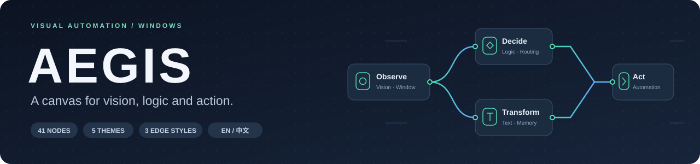
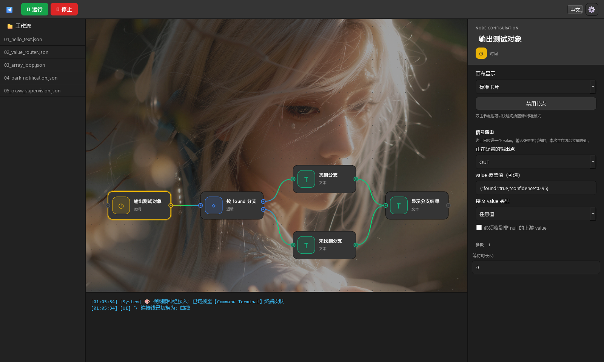
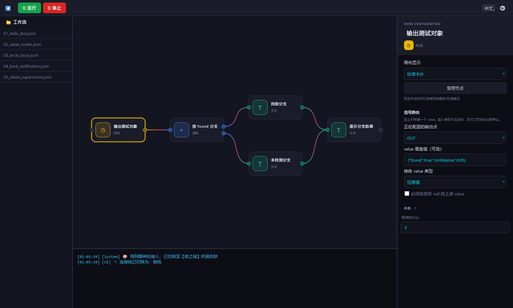
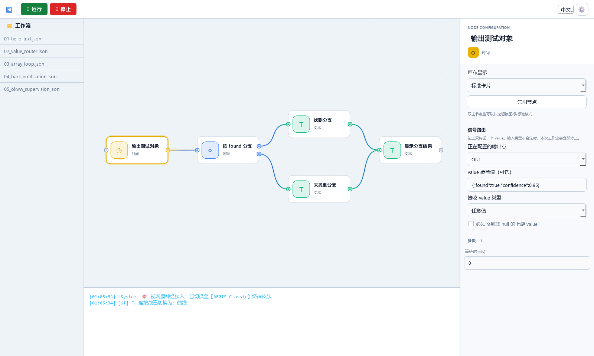
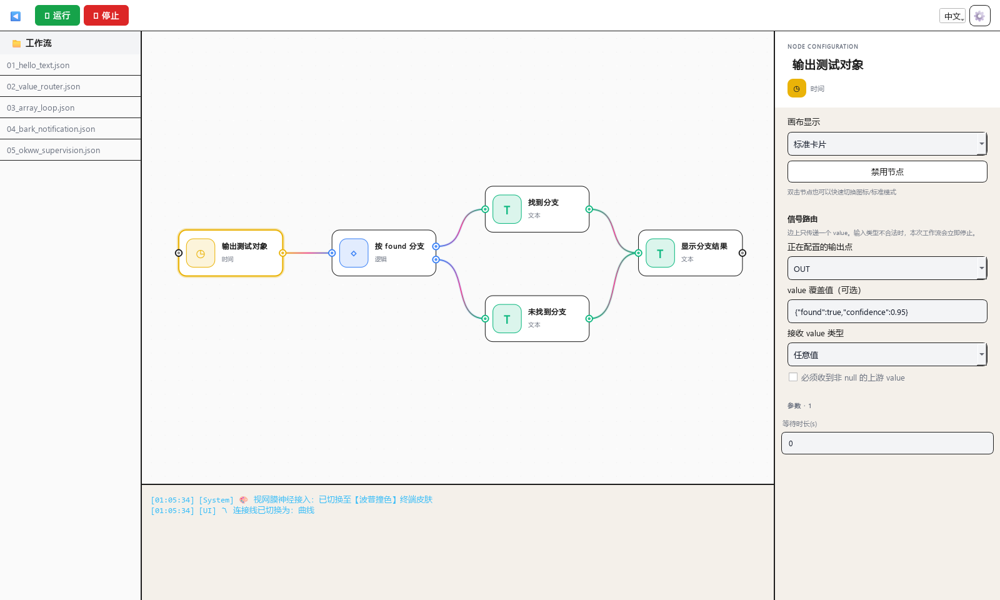
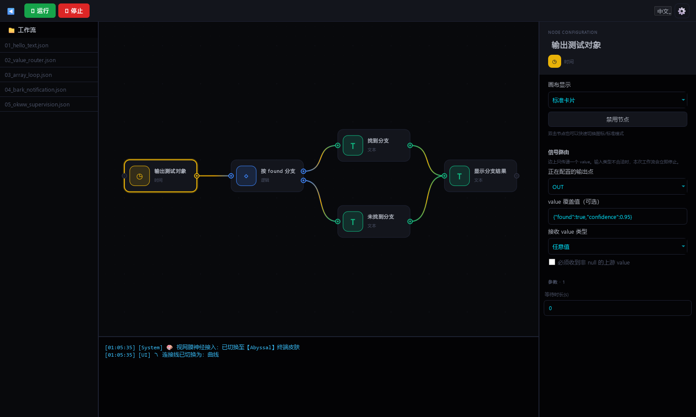
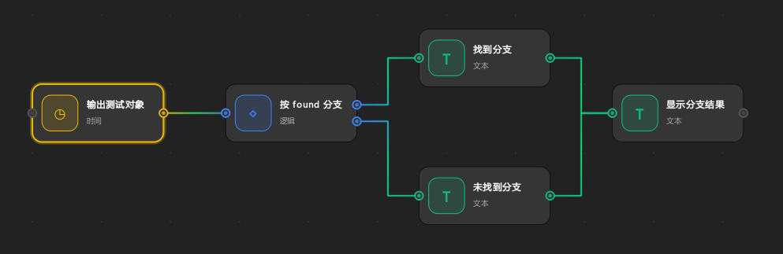
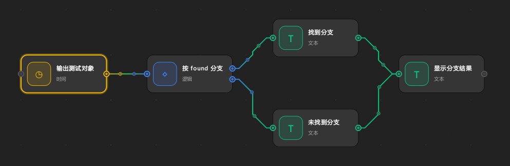
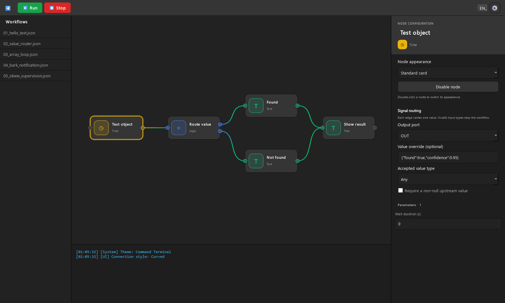
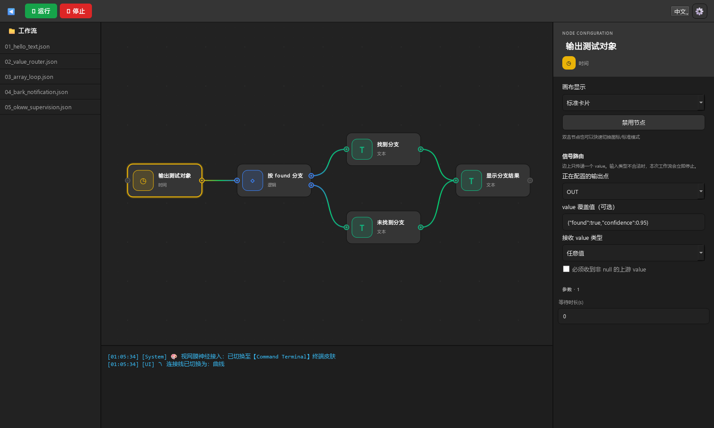

<p align="center">
  
</p>

<p align="center">把视觉、逻辑、文本和操作连成工作流，在自己的桌面上运行。</p>

<p align="center">
  <a href="https://github.com/iLrs9935/AEGIS/actions/workflows/ci.yml"></a>
  <a href="LICENSE"></a>
  
  
</p>

<p align="center">
  <a href="readme.md">English</a> · <strong>简体中文</strong><br>
  <a href="#快速开始">快速开始</a> · <a href="examples/README.md">示例工作流</a> · <a href="#皮肤与连线">皮肤与连线</a> · <a href="SECURITY.md">隐私配置</a>
</p>



<p align="center"><sub>真实软件界面，背景图由项目作者生成。维护状态：不定期维护。</sub></p>

AEGIS 是一个面向 Windows 的节点式自动化编排器。你可以把视觉识别、鼠标键盘、文本处理、逻辑判断、记忆、网络、AI 与系统操作连接成一张可保存、可复用、可循环执行的工作流图。

| 可视化编排 | 明确的数据流 | 自己的工作台 |
| --- | --- | --- |
| 41 种内置节点，支持复用逻辑组、撤销和重做。 | 每条线传递一个有类型的值，工作流保存为可读的 JSON。 | 五套皮肤、三种连线、自定义背景，以及即时中英文切换。 |

## 当前能力

- 无限画布：缩放、平移、框选、多选、复制、粘贴、删除、撤销和重做。
- 两种节点外观：`standard` 标准卡片与 `icon` 纯图标；双击节点即可切换。
- 按需配置面板：未选节点时隐藏，单选节点时在右侧显示参数和信号设置。
- 三种连线：曲线 `curve`、直角线 `orthogonal`、电路板走线 `circuit`。
- 逻辑组：可改名称、颜色、启用状态，可折叠并锁定成员。锁定后移动逻辑组不会误吸入路过的节点。
- 端口语义提示：鼠标停在节点上会显示输出点名称、结果结构或配置的覆盖值。
- 单值数据流：每条连线只传递一个 `value`；它可以是布尔值、数字、文本、对象、数组或 `null`。
- 严格输入契约：节点可以声明接收类型和必需输入；非法类型会立即终止本次工作流，不再静默跳过。
- 动态条件分流：`信号分流器` 的每条可视化规则都会生成一个输出端口，支持字段路径、首个/全部匹配和默认出口。
- 多重连线：一个节点的不同输出端口可以同时连接到同一个接收节点。
- 41 种内置节点，覆盖动作、AI、逻辑、记忆、网络、通知、系统、文本、时间、触发和视觉。
- JSON 工作流：图纸默认保存在 `workflows/`，也可以由 AI 直接生成。

## 快速开始

需要 Windows 和 Python 3.12–3.14。源码发布包不附带本地 Python 环境、模型、DLL 或私人图纸。

```powershell
git clone https://github.com/iLrs9935/AEGIS.git
cd AEGIS
py -3.14 -m venv .venv
.\.venv\Scripts\Activate.ps1
python -m pip install -r requirements.txt
python main.py --lang zh
```

加载示例，或加载后自动运行：

```powershell
python main.py --file examples/workflows/01_hello_text.json
python main.py --file examples/workflows/01_hello_text.json --autorun
```

启动时会将公开示例补齐到本地 `workflows/` 列表；已有同名文件会保留。五个示例的用途与配置见 [examples/README.md](examples/README.md)。前三个示例只处理文本和数据，可直接试跑。

### 软件语言

右上角 **EN / 中文** 菜单可以直接切换语言，并记住选择；新安装默认英文。也可以通过 `--lang en`、`--lang zh` 或 `AEGIS_LANGUAGE` 指定。语言切换保留当前图纸、选中内容与撤销记录。节点类型、配置键和端口标识使用原有兼容格式；你填写的文本、路径等数据保持原文。

### 私人配置

```powershell
Copy-Item config.local.example.json config.local.json
# 在本地编辑 config.local.json，填写 Bark 地址等配置。
# 也可以通过进程环境变量提供相同名称的值，环境变量优先。
```

图纸节点配置使用 `${ENV:AEGIS_BARK_URL}` 等引用，在运行时读取环境变量或 `config.local.json`，不会将解析出的值写回图纸。显式引用缺失时会终止该节点。Bark 节点地址留空时自动读取 `AEGIS_BARK_URL`；均未配置则跳过通知。

AI 推理为可选功能：自行安装适合硬件的 `llama-cpp-python` 并选择本地 GGUF 模型。DLL 路径从当前 Python 包或打包目录发现；可用 `AEGIS_LLAMA_LIB` 指定，CUDA 使用 `CUDA_PATH` / `CUDA_HOME`。DXCAM 也是可选截图后端，基础安装使用其他现有后端。

AEGIS 的键鼠、窗口、视觉和进程能力依赖 Windows API；其他系统仅能运行不依赖 Windows 的源码发布检查。

## 皮肤与连线

右上角 **⚙ → 🎨 换皮肤** 可以即时切换外观。上方展示的是带自定义背景的 **Command Terminal**，以下是另外四套内置主题。换肤会保留当前节点配置和连接关系。

| 夜之城 | AEGIS Classic |
| --- | --- |
|  |  |
| **波普撞色** | **Abyssal** |
|  |  |

### 三种连线风格

通过 **⚙ → 〽 换连接线** 切换。同一张工作流可以使用不同的走线外观，执行逻辑保持一致。

| 曲线 | 直角线 | 电路板走线 |
| --- | --- | --- |
|  |  |  |

通过 **⚙ → 🖼️ 画布背景 → 📂 载入背景图…** 设置自己的图片，再用 **🎛️ 调整透明度…** 保持节点清晰。皮肤和连线偏好会被记住，图纸也可以保存自己的外观设置。

### 英文主界面与中文主界面

右上角 **EN / 中文** 菜单即时切换当前界面。

| 英文主界面 | 中文主界面 |
| --- | --- |
|  |  |

所有预览均来自真实 Qt 应用，使用公开示例数据。点击截图可以查看原始尺寸。

用自己的本地图片重新生成双语主题和连线预览：

```powershell
python scripts/capture_ui.py --gallery --background "你的背景图路径.png" --output release/ui-previews
```

截图使用隔离的偏好设置与公开示例，不会执行工作流。

## 基本使用

1. 在画布空白处打开节点菜单并添加节点。
2. 从节点右侧的输出点拖线到另一个节点左侧的 `IN`。
3. 单击节点，在右侧配置参数、可选的 `value` 覆盖值和严格接收类型。
4. 将鼠标停在节点上，确认输出点分别表示什么。
5. 按 `F5` 运行，按 `Shift+F5` 紧急停止，按 `Ctrl+S` 保存图纸。

左侧是工作流列表，中间是画布，右侧配置面板只在单选节点时出现。右上角设置按钮可以切换皮肤和连接线样式。

### 快捷键

| 快捷键 | 功能 |
| --- | --- |
| `Ctrl+Z` | 撤销 |
| `Ctrl+Y` / `Ctrl+Shift+Z` | 重做 |
| `Ctrl+C` | 复制选中节点/逻辑组及这些节点之间的内部连线 |
| `Ctrl+V` | 粘贴 |
| `Delete` / `Backspace` | 删除选中内容 |
| `Ctrl+G` | 将当前多选节点建立为已锁定逻辑组 |
| `Ctrl+S` | 保存当前图纸 |
| `Ctrl+B` | 显示或隐藏左侧栏 |
| `F5` | 运行工作流 |
| `Shift+F5` | 停止工作流 |

在节点配置输入框中打字时，复制、粘贴和删除仍由输入框自己处理，不会误操作画布。

## value 与信号分流

每个节点只有一个输入端口 `IN`。普通业务节点通过一个正常输出继续执行，并产生一个 `value`。`value` 可以直接是 `true`、`5`、`"ready"`，也可以是包含多个字段的对象。

运行时连线只传递下面的数据包：

```python
{
    "source_id": "来源节点 ID",
    "source_port": "实际触发的输出端口",
    "value": {
        "found": True,
        "target_x": 100,
        "target_y": 200,
        "confidence": 0.91
    }
}
```

执行状态不属于业务数据：正常没找到图片是 `value.found == false`，截图后端异常才是 `Failed`。`false` 是合法值，不会导致 Skip。

`signal_config` 只包含两部分：

- `outputs.<端口>.value`：可选覆盖值；留空时使用节点函数实际返回的 `value`。
- `input.type`：`any`、`boolean`、`number`、`string`、`object`、`array` 或 `null`。
- `input.required`：为 `true` 时，缺失或 `null` 输入会终止本次工作流。

`信号分流器`默认原样转发输入 `value`。规则可以判断整个 value，也可以用字段路径判断对象内容。例如视觉寻图输出对象后，使用 `found / 等于 / true` 与 `found / 等于 / false` 两条规则，就会动态生成两个输出端口。未命中规则默认终止工作流，也可显式选择默认出口。

### 进阶工作流

[OK-WW 监控示例](examples/workflows/05_okww_supervision.json) 演示进程预检、日志证据、限次重试、通知与安全清理。需要设置 `AEGIS_OKWW_EXE` 并检查日志与脚本路径；默认保留终端，不执行休眠。

`tests/fixtures/1.json` 保留兑换码视觉流程，使用脱敏 URL 和虚构程序路径，供回归测试参考。兑换码发现与已处理状态分开存储；只有执行“记录兑换码结果”后才标记已处理。视觉步骤使用“视觉寻图 → 信号分流器 → 物理点击”，遍历器逐条传递字符串 `value`。

## 工作流 JSON

保存文件的顶层固定为 `meta`、`nodes`、`groups`、`edges`：

```json
{
  "meta": {
    "theme": "Command Terminal",
    "edge_style": "curve"
  },
  "nodes": [
    {
      "id": "wait-1",
      "type": "等待时间",
      "name": "等待 2 秒",
      "category": "时间",
      "display_mode": "standard",
      "x": 0,
      "y": 0,
      "w": 190,
      "h": 84,
      "_expanded_height": 84,
      "config": {
        "等待时长(s)": "2.0"
      },
      "signal_config": {
        "outputs": {
          "OUT": {
            "value": ""
          }
        },
        "input": {
          "type": "any",
          "required": false
        }
      },
      "is_disabled": false,
      "is_collapsed": false
    }
  ],
  "groups": [],
  "edges": []
}
```

关键约束：

- `type` 必须是已注册节点类型；`name` 可以改成更易读的显示名称。
- `display_mode` 只能是 `standard` 或 `icon`，对应尺寸分别为 `190×84` 和 `76×76`。
- 边的 `src_port` 必须是来源节点真实存在的输出端口，`tgt_port` 目前固定为 `IN`。
- 逻辑组的 `member_ids` 必须引用真实节点 ID；`color` 使用 `#RRGGBB`。
- 主题可选：`Command Terminal`、`夜之城`、`AEGIS Classic`、`波普撞色`、`Abyssal`。
- 连线可选：`curve`、`orthogonal`、`circuit`。
- 老图纸缺少 `type`、`display_mode`、`signal_config` 或新逻辑组字段时，加载器会尽量迁移；旧版视觉寻图的双出口会在内存中转换为单 `OUT` 加显式分流器。

### 让 AI 直接生成图纸

完整、可直接复制给 AI 的提示词和全部节点目录见 [AI_WORKFLOW_PROMPT.md](AI_WORKFLOW_PROMPT.md)。把该文件中的提示词发给 AI，再补一句你的自动化需求，要求它只返回 JSON；将结果保存到 `workflows/任意名称.json` 后即可在 AEGIS 中加载。

## 逻辑组

框选或多选节点后按 `Ctrl+G` 会创建逻辑组并锁定当前成员。逻辑组支持：

- 自定义标题与颜色；
- 整组启用或禁用；
- 折叠或展开；
- 锁定或解锁成员关系；
- 整组移动、复制、粘贴和删除。

锁定后，成员由 `member_ids` 固定，不再根据节点是否碰巧落入组框来重新计算，因此拖动逻辑组经过其他节点也不会把它们吸入。

## 项目结构

```text
PJ_AEGIS/
├─ main.py                   # 程序入口与 --file / --autorun 参数
├─ core/
│  ├─ engine.py              # MultiDiGraph 调度、依赖锁、回溯线与执行
│  ├─ signals.py             # 端口级类型信号协议
│  └─ event_bus.py           # 引擎与界面的事件总线
├─ nodes/
│  ├─ __init__.py            # @register_node 与自动扫描
│  ├─ actions.py             # 鼠标、粘贴及键盘节点
│  ├─ keyboard_backend.py    # 键盘组合键、打字与粘贴后端
│  ├─ logic.py               # 逻辑门、遍历器与信号分流器
│  ├─ vision.py              # 视觉寻图节点
│  └─ ...                    # AI、记忆、网络、通知、系统、文本、时间等
├─ functions/                # 鼠标、窗口、视觉、网络、进程等底层能力
├─ ui/
│  ├─ main_window.py         # 主窗口、保存加载、设置与运行入口
│  ├─ graph_view.py          # 画布交互、选择、剪贴板与历史记录
│  ├─ graph_items.py         # 节点、端口、连线和逻辑组绘制
│  ├─ node_inspector.py      # 右侧节点与端口信号配置
│  └─ theme.py               # 主题和连线样式
├─ examples/workflows/       # 可公开的示例图纸
├─ workflows/                # 本地图纸（Git 忽略）
├─ config.local.example.json # 私人配置模板
├─ scripts/check_release.py  # 源码与敏感信息检查
├─ scripts/export_github.py  # 白名单源码 ZIP 导出
└─ AI_WORKFLOW_PROMPT.md     # 给 AI 的工作流生成提示词
```

## 添加节点

新增节点通常只需在 `nodes/` 中定义 Schema、注册处理函数并返回执行结果：

```python
from nodes import register_node

schema = {
    "__out_ports__": ["OUT"],
    "节点标签": "示例节点"
}

@register_node(name="示例节点", category="示例", schema=schema)
def example_node(config, inputs):
    return {
        "status": "Success",
        "active_port": "OUT",
        "value": {
            "ok": bool(some_condition),
            "result": 5
        }
    }
```

节点遇到运行时异常应直接抛出异常，让引擎把本次工作流标记为失败；不要用 `false` 表示引擎错误。需要分支时在该节点后连接 `信号分流器`。分流器本身可以通过 `active_ports` 激活一条或多条匹配规则，并原样转发输入 `value`。

## 安全提醒

AEGIS 可以真实发送键鼠输入、关闭进程、启动程序和执行系统休眠。首次运行新图纸时，建议先检查所有路径、窗口名、点击模式和结束进程目标，并随时准备使用 `Shift+F5` 停止。

## 测试与 GitHub 发布准备

```powershell
python -m unittest discover -s tests -v
python scripts/check_release.py
python scripts/export_github.py --output release/AEGIS-github-source.zip
```

源码 ZIP 只包含白名单文件和逐文件 SHA256 清单。不要直接压缩整个工作目录；私人配置、数据库、通知队列、旧构建和备份均应保留在本地。现有 Git 索引中的非公开文件也会被检查。仓库包含 GitHub Actions 的源码检查与 Windows Python 3.12 / 3.14 测试工作流。

重新打包 EXE：

```powershell
python -m pip install -r requirements-build.txt
python pyinstaller.py
```

打包脚本先执行发布检查，只附带公开示例和已审阅的图片模板。可选本地推理 DLL 默认不附带；需要时设置 `AEGIS_BUNDLE_LLAMA=1` 并自行准备 `dlls/` 及其依赖。旧构建不代表当前源码。

更多配置与发布边界见 [SECURITY.md](SECURITY.md)，本次审阅记录见 [RELEASE_REVIEW.md](RELEASE_REVIEW.md)。

## 维护与许可证

不定期维护，不保证固定更新频率或响应时间。欢迎提交问题和改进。

采用 [MIT 许可证](LICENSE)。作者署名为 iLrs9935；分发副本或二创时应保留版权与许可声明。
