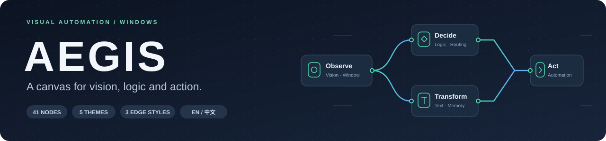
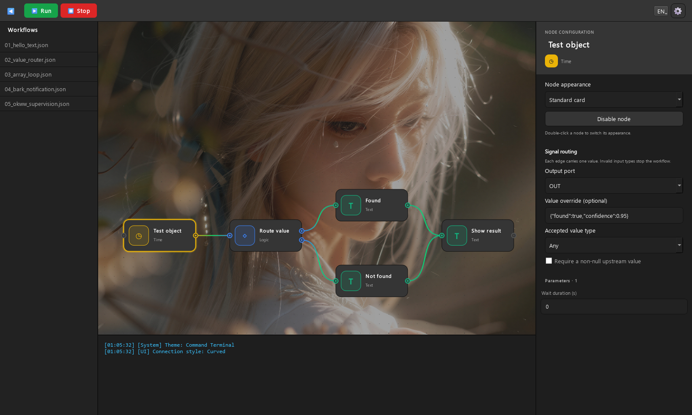
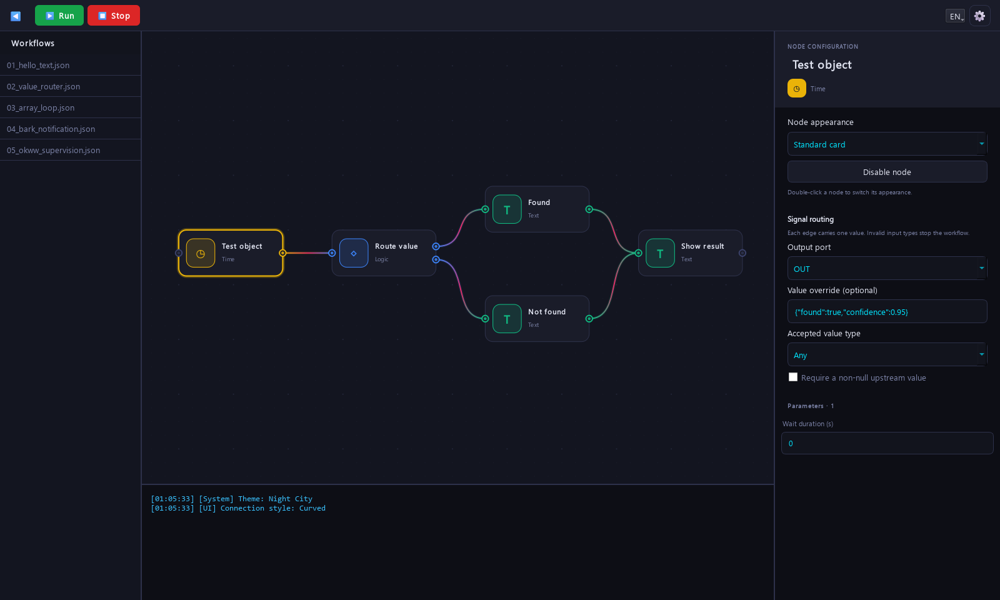
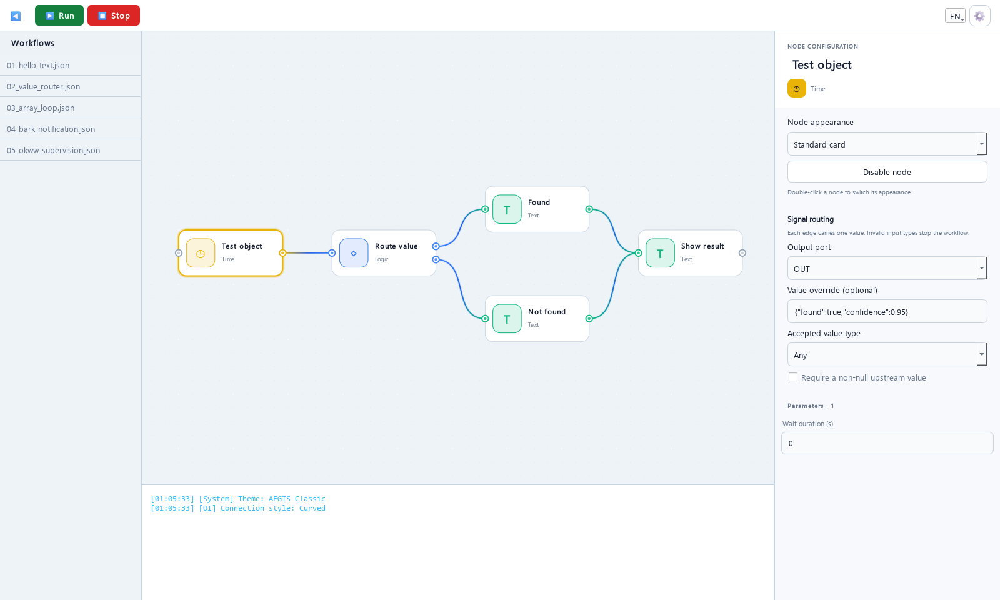
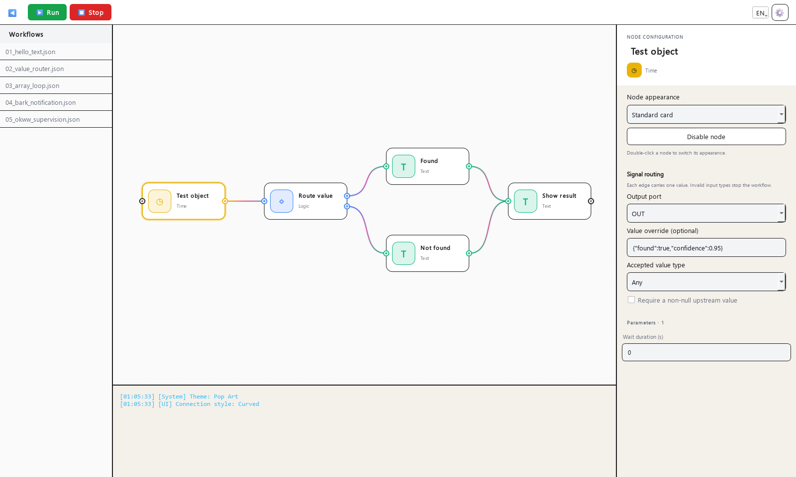
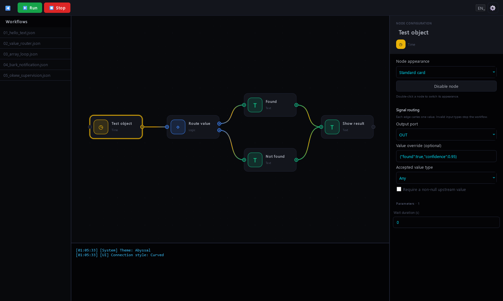
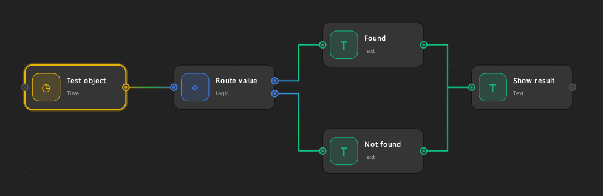
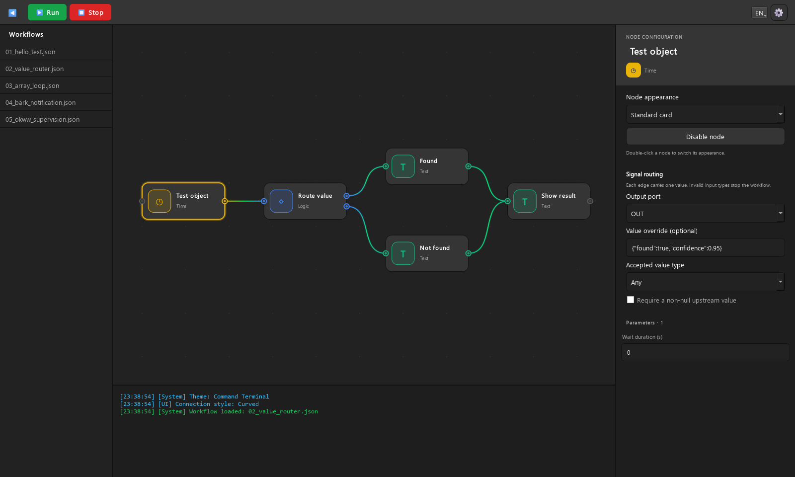
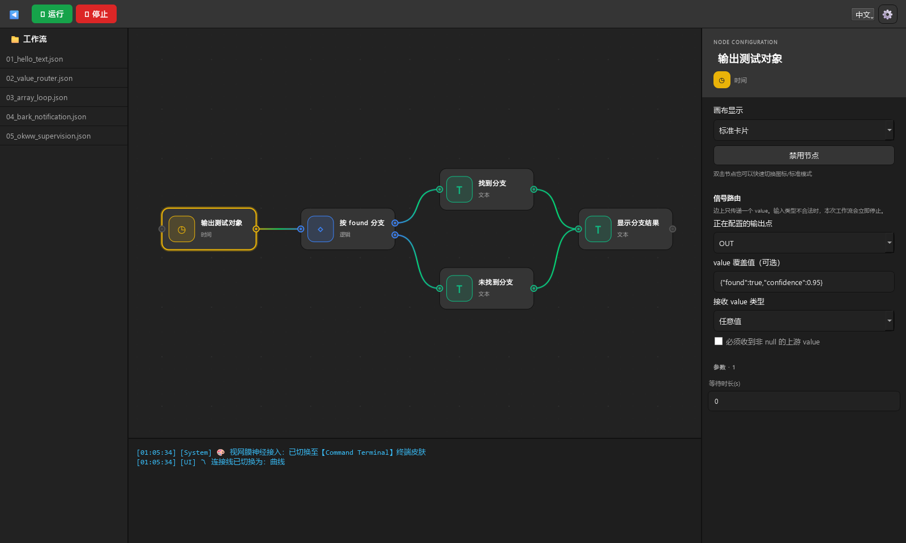

<p align="center">
  
</p>

<p align="center">
  Connect vision, logic, text and actions. Save a workflow. Run it on your desktop.
</p>

<p align="center">
  <a href="https://github.com/iLrs9935/AEGIS/actions/workflows/ci.yml"></a>
  <a href="LICENSE"></a>
  <a href="https://github.com/iLrs9935/AEGIS/releases/latest"></a>
  
  
</p>

<p align="center">
  <strong>English</strong> · <a href="README.zh-CN.md">简体中文</a><br>
  <a href="#download">Download</a> · <a href="#quick-start">Run from source</a> · <a href="#example-workflows">Examples</a> · <a href="#appearance">Themes &amp; connections</a> · <a href="SECURITY.md">Private configuration</a>
</p>



<p align="center"><sub>Real AEGIS interface. Custom background generated by the project author. Maintenance: occasional updates.</sub></p>

AEGIS is a Windows desktop workflow editor for computer vision, mouse and keyboard actions, logic, persistent memory, notifications, optional local AI, and system operations.

| Build visually | Keep the data explicit | Make the canvas yours |
| --- | --- | --- |
| Connect 41 built-in node types, reuse groups, undo and redo. | Each edge carries one typed value; workflows are readable JSON. | Five themes, three connection styles, custom backgrounds, English and Chinese. |

## Features

- Zoomable canvas with selection, copy and paste, undo and redo, and reusable logic groups.
- Standard cards or compact icons, with curved, orthogonal, or circuit-style connections.
- A configuration inspector that appears when a node is selected.
- One `value` per edge: booleans, numbers, strings, objects, arrays, or null.
- Strict input contracts and explicit routing rules; invalid input stops the workflow.
- JSON workflows that can be inspected, saved, reused, and generated with AI assistance.
- English and Simplified Chinese interface controls, node menus, configuration labels, choices, and port labels.
- Optional local model inference, browser scraping, and reliable Bark notifications with a local outbox.

## What changed in v3.0.1

- Run-isolated, thread-safe context and scoped execution signals.
- Explicit click coordinate modes; missing coordinates fail without clicking.
- Per-run workflow authorization, checked by both the engine and workers. `--safe-power` now enforces read-only workflow capabilities.
- [English](docs/LLM_WORKFLOW_QUICKSTART.en.md) / [中文](docs/LLM_WORKFLOW_QUICKSTART.md) quickstarts for LLM workflow generation, with complete JSON examples.

The Chinese [manual validation record](docs/MANUAL_VALIDATION.md) records user-confirmed real keyboard/mouse, Bark, OK-WW/game and hibernation tests separately from automated evidence. Detailed engineering and experiment records remain in Chinese.

## Download

**[Download AEGIS v3.0.1 for Windows x64](https://github.com/iLrs9935/AEGIS/releases/download/v3.0.1/AEGIS-v3.0.1-windows-x64.zip)** — portable ZIP, no separate Python installation required.

1. Extract the entire ZIP into a writable folder.
2. Run **AEGIS Command Terminal.exe**, keeping `_internal` beside it.
3. Choose **EN / 中文** and open one of the five included workflows.

| File | Use |
| --- | --- |
| [Windows x64 portable ZIP](https://github.com/iLrs9935/AEGIS/releases/download/v3.0.1/AEGIS-v3.0.1-windows-x64.zip) | Run the application |
| [Audited source ZIP](https://github.com/iLrs9935/AEGIS/releases/download/v3.0.1/AEGIS-v3.0.1-source.zip) | Read or build the release source, with a file manifest |
| [SHA256SUMS.txt](https://github.com/iLrs9935/AEGIS/releases/download/v3.0.1/SHA256SUMS.txt) | Verify the downloaded archives |

The standard portable edition includes the editor, vision/keyboard/mouse features and OK-WW nodes. Optional llama-cpp-python, model weights, CUDA libraries and DXCAM are not bundled; use a source/custom build for those backends. OK-WW itself is installed separately. The Windows executable is unsigned. See the [portable guide](docs/PORTABLE.md) for private configuration and bundled dependency licenses.

## Quick start

To run from source or prepare a custom build:

Requires **Windows** and **Python 3.12–3.14**. The source repository excludes private workflows, local settings, databases, Python environments, model weights, and native DLL bundles.

```powershell
git clone https://github.com/iLrs9935/AEGIS.git
cd AEGIS
py -3.14 -m venv .venv
.\.venv\Scripts\Activate.ps1
python -m pip install -r requirements.txt
python main.py --lang en
```

New installations start in English. Use the **EN / 中文** menu at the top right to switch immediately; the application remembers the selection. You can also use `--lang zh` or set `AEGIS_LANGUAGE` to `en` or `zh`.

Switching languages preserves the graph, selection, settings, and undo history. Workflow type names, configuration keys, and port identifiers retain their compatible serialized format. User-authored text and paths stay as entered; diagnostic messages from individual backends may retain their original language.

Open a public example:

```powershell
python main.py --lang en --file examples/workflows/01_hello_text.json
```

Add `--autorun` to execute after loading. On startup, missing examples are copied into the local `workflows/` list; existing files are preserved.

## Example workflows

| Example | Purpose | Configuration |
| --- | --- | --- |
| [Text and wait](examples/workflows/01_hello_text.json) | Enter text, wait briefly, and display it | None |
| [Value routing](examples/workflows/02_value_router.json) | Route an object by its `found` field and merge branches | None |
| [Array loop](examples/workflows/03_array_loop.json) | Iterate over three items using a feedback connection | None |
| [Bark notification](examples/workflows/04_bark_notification.json) | Send a completion notification, with a durable outbox | Requires `AEGIS_BARK_URL`; sends a real notification |
| [OK-WW supervision](examples/workflows/05_okww_supervision.json) | Check ownership, monitor logs, retry, and clean up a task session | Requires `AEGIS_OKWW_EXE` and installation-specific paths; keeps the terminal open by default |

The first three examples only process text and data. The OK-WW example can launch applications and terminate processes owned by its task session; inspect its configuration before using it.

## Appearance

Open **⚙ → Theme** to switch skins instantly. **Command Terminal** is shown above; four other built-in themes are shown below. Node configuration and connections stay in place when you change the appearance.

| Night City | AEGIS Classic |
| --- | --- |
|  |  |
| **Pop Art** | **Abyssal** |
|  |  |

### Three ways to connect

Use **⚙ → Connections** to choose a style. These are three captures of the same graph; the workflow logic stays the same.

| Curved | Orthogonal | Circuit |
| --- | --- | --- |
|  |  |  |

Use **⚙ → Canvas background → Load background image…** for your own image, then **Adjust opacity…** to keep the graph readable. Theme and connection preferences are remembered; workflow files can also carry their own appearance settings.

### English and Chinese, side by side

The top-right **EN / 中文** menu switches the current interface immediately.

| English interface | 中文主界面 |
| --- | --- |
|  |  |

All previews are captured from the actual Qt application with public example data. Click a screenshot to inspect it at full size.

## Private configuration

```powershell
Copy-Item config.local.example.json config.local.json
```

Edit `config.local.json` locally to provide actual values. Alternatively, supply process environment variables with the same names. Environment variables take precedence.

In a node's `config`, use a reference such as `${ENV:AEGIS_BARK_URL}`. AEGIS resolves it just before execution and preserves the reference when saving the graph. A missing explicit reference fails the node. A blank Bark URL uses `AEGIS_BARK_URL` automatically; if neither is set, notification delivery is skipped.

Keep device URLs, API keys, and other credentials out of public examples. `config.local.json`, local workflows, logs, databases, backgrounds, and notification queues are ignored by Git. AEGIS does not automatically load `.env` files.

For optional local AI inference, install a suitable `llama-cpp-python` build and select a local GGUF model. Native library discovery uses the active Python package or application bundle. `AEGIS_LLAMA_LIB` can override the library directory; CUDA discovery respects `CUDA_PATH` or `CUDA_HOME`. DXCAM is an optional capture backend.

## Using the canvas

1. Right-click empty canvas space to add a node.
2. Connect an output port to the next node's `IN` port.
3. Select a node to edit its parameters and input/output contracts.
4. Hover over a node to inspect port descriptions.
5. Press **F5** to run and **Shift+F5** to stop.

| Shortcut | Action |
| --- | --- |
| Ctrl+S | Save workflow |
| Ctrl+Z | Undo |
| Ctrl+Y / Ctrl+Shift+Z | Redo |
| Ctrl+C / Ctrl+V | Copy / paste selected nodes and groups |
| Delete / Backspace | Delete selection |
| Ctrl+G | Create a locked group from selected nodes |
| Ctrl+B | Toggle the workflow sidebar |
| F5 / Shift+F5 | Run / stop |

Text fields keep their normal editing shortcuts. Double-click a node to switch between icon and standard-card views.

## Workflow format

A workflow contains `meta`, `nodes`, `groups`, and `edges`. Each edge carries one value plus its source node and output port. Receiver contracts accept `any`, `boolean`, `number`, `string`, `object`, `array`, or `null`.

Node execution status is separate from business data: an image search returning `found: false` is a valid result; a capture backend exception is a failure. Use a Value router for branches.

Start with the [LLM workflow quickstart](docs/LLM_WORKFLOW_QUICKSTART.en.md), including two complete JSON examples, then inspect the included workflows. The detailed [Chinese workflow-generation prompt](AI_WORKFLOW_PROMPT.md) lists canonical node identifiers and schemas. These identifiers remain the same in the English interface.

## Tests and source publishing

Real mouse/keyboard, Bark, OK-WW/game and hibernation have passed [user-reported manual validation](docs/MANUAL_VALIDATION.md). These records remain separate from automated test evidence.

```powershell
python scripts/run_tests.py --report release/test-report.json
python scripts/check_release.py
python scripts/export_github.py --output release/AEGIS-github-source.zip
```

The export script audits an explicit allowlist, excludes local private data, and adds a per-file SHA256 manifest. The audit also checks the Git index for private files and stale staged credentials. Do not upload an archive of the entire working directory or reuse old binaries and backups as release attachments.

GitHub Actions runs the source audit and Windows tests on Python 3.12, 3.13 and 3.14. The Windows-specific application features do not run on Linux or macOS.

To reproduce the bilingual theme and connection gallery with your own local image:

```powershell
python scripts/capture_ui.py --gallery --background "path\to\your-background.png" --output release/ui-previews
```

The capture uses isolated preferences and public examples; it does not run the workflows.

## Build an executable

```powershell
python -m pip install -r requirements-build.txt
python scripts/build_portable.py --version 3.0.1 --output release/my-v3.0.1-build
```

The portable builder copies an audited public-only snapshot into a fresh directory, builds the Windows executable, includes dependency licenses and examples, and emits Windows/source ZIPs with SHA256 checksums. It requires a clean standard build environment and preserves existing output directories.

For a custom PyInstaller directory, use `python pyinstaller.py` after installing the necessary optional dependencies. The reviewed spec only includes public workflows and approved image templates. Optional native inference DLLs require `AEGIS_BUNDLE_LLAMA=1` and locally supplied dependencies under `dlls/`.

AEGIS performs real keyboard, mouse, process, file, network and power actions. Every run containing these effects requires an explicit review, including local, imported and AI workflows; direct engine calls default to denial. Grants apply to one exact run, never to a nested workflow. `--safe-power` now enforces read-only workflow capabilities, also blocking indirect power paths through process launch or keyboard input. It is not an OS sandbox: trusted Python extensions and application-owned initialization/logging remain outside this boundary.

Click nodes require an explicit coordinate mode. Imported legacy click nodes migrate to specified coordinates with a warning; missing coordinates fail. Choose current cursor position explicitly when intended. Run contexts are isolated and thread-safe; nested mutable data must use atomic updates rather than mutate a returned snapshot. See [engineering remediation and limits](docs/ENGINEERING_REMEDIATION.md) and [test evidence conventions](docs/TESTING.md).

## Inspiration and development

AEGIS was inspired by [ComfyUI](https://github.com/Comfy-Org/ComfyUI) and [n8n](https://github.com/n8n-io/n8n), particularly their node-based interfaces and visual workflow design.

This software was developed primarily with the help of **ChatGPT** and **Gemini**.

The author plays **Wuthering Waves**, which is why AEGIS includes a dedicated set of **OK-WW nodes**. See the [OK-WW project](https://github.com/ok-oldking/ok-wuthering-waves).

## Maintenance and license

Maintenance is **occasional / 不定期维护**. Issues and pull requests are welcome; response times and future releases are not guaranteed.

Copyright © 2026 [iLrs9935](https://github.com/iLrs9935). Licensed under the [MIT License](LICENSE). Preserve the copyright and license notice when distributing copies or derivatives.

See [security and private configuration notes](SECURITY.md) and the [release review](RELEASE_REVIEW.md) for the publication boundaries.
